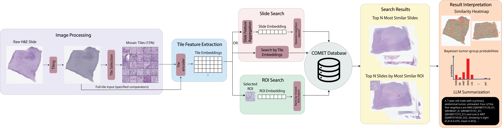

<div align="center">

# PROSPER

### An Interpretable Whole Slide Image Search System for Pediatric Cancer Pathology

[](https://www.python.org/downloads/)
[](https://www.apache.org/licenses/LICENSE-2.0)

[Overview](#overview) •
[Installation](#installation) •
[Quick start](#quick-start) •
[Repository layout](#repository-layout) •
[Reproducing the paper](#how-the-code-maps-to-the-paper) •
[Data access](#data-access) •
[Limitations](#limitations) •
[Citation](#citation)

</div>

---

> **Research use only.** PROSPER retrieves morphologically similar reference
> cases for a pathologist to inspect. Retrieval performance is not diagnostic
> accuracy, and PROSPER is not a diagnostic device.

## Overview

<div align="center">

</div>

<br>

**PROSPER** extracts tile embeddings from whole slide images (WSIs) with
pathology foundation models, aggregates them into slide-level representations
and searches a reference library for morphologically similar slides or
regions. It was developed and evaluated on pediatric solid tumors. The
components are:

- **Slide search**: rank reference slides by similarity to a query slide.
- **Region-of-interest (ROI) search**: find tissue regions similar to a
  selected 512×512 region.
- **Tile encoders**: Virchow2 (default), UNI2, UNI and GigaPath through the
  pipeline CLI; the revision benchmark also evaluated further encoders (see
  [docs/REPRODUCTION.md](docs/REPRODUCTION.md)).
- **Slide similarity formulations**: SAMPLER (percentile), Bag-of-Barcodes
  (BoB) and Optimal Transport (OT) in the pipeline CLI; median pooling and
  Yottixel were evaluated in the benchmark.
- **Interpretability**: OT correspondence heatmaps that show which tissue
  regions drove a slide-to-slide match, and ROI-to-slide similarity heatmaps.
- **Bayesian tumor-group probabilities**: a kernel-weighted nearest-neighbor
  estimate of tumor-group support among the retrieved reference slides. These
  describe relative support within the reference library; they are **not
  calibrated diagnostic probabilities**, and they also reflect the class
  composition of the library.
- **LLM summary**: an optional short narrative of the retrieved reference
  cases' metadata, with inline case-ID citations and targeted automatic checks
  of cited identifiers and numbers. It summarizes retrieved metadata; it does
  not make a diagnosis.

## Pipeline

```
┌─────────────────┐      ┌──────────────────┐      ┌─────────────────┐      ┌──────────────┐
│  Whole slide    │─────▶│     Mosaic       │─────▶│      Tile       │─────▶│    Slide     │
│  images (.svs)  │      │   generation     │      │   embeddings    │      │  similarity  │
└─────────────────┘      └──────────────────┘      └─────────────────┘      │ (SAMPLER/    │
                                                                            │   BoB/OT)    │
                                                                            └──────────────┘
                                                                                    │
                                    ┌───────────────────────────────────────────────┘
                                    ▼
                              ┌────────────┐      ┌─────────────────┐
                              │   Search   │─────▶│   Results and   │
                              │            │      │  visualization  │
                              └────────────┘      └─────────────────┘
                                    │                      │
                                    ▼                      ▼
                              ┌────────────┐      ┌─────────────────┐
                              │  Bayesian  │─────▶│   LLM summary   │
                              │ tumor-group│      │   (optional)    │
                              │   support  │      │                 │
                              └────────────┘      └─────────────────┘
```

## Methods in brief

### Tile encoders

Each slide is tiled into 512×512 tiles, and a mosaic of representative tiles
(15% of tiles per slide in the manuscript configuration) is encoded by a
pretrained pathology foundation model.

| Model | Embedding dim | Features used | Source |
|-------|---------------|---------------|--------|
| **Virchow2** | 2560 | First 1280 (class token) | Paige |
| **UNI2** | 1536 | 1536 | Mahmood Lab |
| **UNI** | 1024 | 1024 | Mahmood Lab |
| **GigaPath** | 1536 | 1536 | Providence |

The encoder benchmark in the manuscript compares eight foundation models
(Virchow2, UNI2, GigaPath, EXAONEPath, Phikon v2, CTransPath, Hibou-L and
H-Optimus-1), RetCCL and SimCLR, and separate comparator pipelines (CONCH v1.5
with TITAN, PRISM and SISH). The evaluation code for these is in
`prosper/embeddings/`, `prosper/evaluation/`, `prosper/baselines/` and
`revision/scripts/`.

### Slide similarity

| Method | Description |
|--------|-------------|
| **SAMPLER** | Percentile-based aggregation of tile embeddings |
| **BoB** | Bag-of-Barcodes binary encoding |
| **OT** | Optimal Transport between tile sets; supports correspondence visualization |

### Bayesian tumor-group probabilities

After retrieval, PROSPER sums exponential kernel weights of the *k* nearest
reference slides that carry each tumor-group label and normalizes over all *k*
neighbors (Methods, "Bayesian posterior approximation for tumor-group
probabilities"). Because the sums are not divided by class size, the estimates
reflect the composition of the reference library. Use them as relative support
within that library, not as diagnostic probabilities; interpreting them as
absolute diagnostic probabilities would require further calibration.

| Parameter | Package default | Description |
|-----------|-----------------|-------------|
| `n_neighbors` | 20 | Number of nearest neighbors |
| `temperature` | 20.0 | Kernel parameter *T* |

The manuscript reports *k* = 5 and *k* = 18 with *T* = 20.

### Interpretability visualization

| Visualization | Input | Output |
|---------------|-------|--------|
| **Slide-to-slide OT heatmap** | OT transport plan + slide pair | Tiles colored by transport-weighted similarity, side by side |
| **ROI-to-slide heatmap** | Tile embeddings + query ROI | Cosine similarity of every tile to the query region, over a slide thumbnail |

### LLM summary

The optional summarizer turns retrieval output into a short narrative:

1. **Payload**: a JSON record with the query's metadata as supplied to the
   pipeline and the top-*k* neighbors with their metadata, distances, and
   deterministic neighbor statistics (and, when computed, Bayesian tumor-group
   probabilities) prepared before any model call.
2. **Generation**: a schema-guided call requesting a narrative of at most 200
   words with inline `[case_id]` citations and a list of atomic claims.
3. **Checks**: targeted automatic checks of cited identifiers, selected claim
   fields and numerical tokens.

The summary is a cited summary of the retrieved cases' metadata, not a
diagnosis. In the manuscript's five-neighbor pilot, the payload **withheld
the query's tumor group, diagnosis, discrepant flag and evaluation fields and
masked its identifier**; the pilot code is in `revision/scripts/llm_pilot_round2/`.
If you use the package summarizer, decide which query fields to supply. The
evaluated configuration used GPT-5 through Azure OpenAI; LLM output is not
deterministic. Requires API credentials in environment variables (see below).

## Installation

### Quick install

```bash
git clone https://github.com/stjude/prosper-search.git
cd prosper-search

chmod +x scripts/install.sh
./scripts/install.sh --conda
```

### Option 1: Conda

```bash
conda env create -f environment.yml
conda activate prosper
pip install -e .
```

### Option 2: Docker

```bash
docker build -t prosper:latest .

docker run --gpus all -v /path/to/slides:/data -v /path/to/output:/output \
    prosper:latest python -m prosper.cli --slide-path /data --output-dir /output
```

### Option 3: pip

```bash
python -m venv venv
source venv/bin/activate

# OpenSlide (system dependency)
# Ubuntu: sudo apt-get install openslide-tools python3-openslide
# macOS: brew install openslide

pip install -r requirements.txt
pip install -e .
```

The environments recorded for the manuscript runs are listed in
[docs/ENVIRONMENT.md](docs/ENVIRONMENT.md).

### Foundation models

```bash
huggingface-cli login
python scripts/setup_models.py --model virchow2
python scripts/setup_models.py --all
```

You must accept each model's licence on Hugging Face:
[Virchow2](https://huggingface.co/paige-ai/Virchow2) (first 1280 features, class token),
[UNI2](https://huggingface.co/MahmoodLab/UNI2-h),
[GigaPath](https://huggingface.co/prov-gigapath/prov-gigapath).

## Data download

> **Data access:** the reference data are **not** a public self-serve
> download. They follow St. Jude institutional approval. Use the commands
> below only after you have an authorized source. See
> [data/README.md](data/README.md) and [docs/DATA_ACCESS.md](docs/DATA_ACCESS.md).

The demo and pre-computed search need data files (~14 GB in total when
obtained through an approved channel).

```bash
python scripts/download_data.py --list
python scripts/download_data.py --all
python scripts/download_data.py --essential        # basic search (~10 GB)
python scripts/download_data.py --patch-embeddings # ROI search
python scripts/download_data.py --sample-slide     # demo
```

- **Internal mirror (optional)**: set `PROSPER_INTERNAL_DATA_SOURCE` to use
  your organization's internal mirror.
- **Git LFS**: large files tracked with Git LFS (`git lfs pull` after cloning).

## Quick start

### Python API

```python
from prosper import ProsperPipeline, ProsperConfig

config = ProsperConfig(
    slide_path="/path/to/slides",
    output_dir="./output",
    patch_model="virchow2",                # virchow2 | uni2 | uni | gigapath
    slide_embedding_method="percentile",   # percentile | bob | ot
)
pipeline = ProsperPipeline(config)
results = pipeline.run()
```

### Command line

```bash
# Default pipeline (Virchow2 + percentile)
python -m prosper.cli --slide-path /path/to/slides --output-dir ./output

# Other encoder and similarity formulation
python -m prosper.cli --slide-path /path/to/slides \
    --patch-embedding uni2 --slide-embedding ot

# Bayesian tumor-group probabilities and the optional LLM summary
python -m prosper.cli --slide-path /path/to/slides --proba --llm

# ROI search for a specific region
python -m prosper.cli --slide-path /path/to/slides --roi-search --coords 1024,2048

# YAML configuration (CLI flags override config values)
python -m prosper.cli --config configs/config.example.yaml
```

<details>
<summary><b>CLI reference</b></summary>

| Argument | Default | Description |
|----------|---------|-------------|
| `--patch-embedding` | `virchow2` | Tile encoder: `virchow2`, `uni2`, `uni`, `gigapath` |
| `--slide-embedding` | `percentile` | Slide similarity: `percentile`, `bob`, `ot` |
| `--roi-search` | off | Enable ROI (tile-level) similarity search |
| `--coords X,Y` | — | Upper-left corner of the 512×512 region (implies `--roi-search`) |
| `--proba` | off | Compute Bayesian tumor-group probabilities |
| `--llm` | off | Generate the LLM summary (requires API credentials) |
| `--top-k` | `10` | Number of similar slides to return |
| `--distance-metric` | `l1` | `l1`, `l2`, `cosine` |
| `--device` | `cuda` | `cuda`, `cpu` |
| `--batch-size` | `64` | Batch size for feature extraction |
| `--smoketest` | off | Quick test with limited slides |
| `--force-recompute` | off | Recompute all steps |
| `--config` | — | YAML configuration file |
| `--single-slide` | — | Process one slide against a pre-built reference database |
| `--step` | — | Run one step: `mosaic`, `patch-embedding`, `slide-embedding`, `search`, `bayesian`, `llm` |

</details>

### Demo

```bash
jupyter notebook examples/demo.ipynb
```

The notebook walks through processing a sample slide, slide and ROI search,
OT heatmaps, Bayesian tumor-group probabilities and the LLM summary. It needs
the approved data bundle.

### Output structure

```
output/
├── mosaic/                              # Tissue tiles
├── patch_embeddings/{model}/            # Tile features
├── slide_embeddings/{model}_{method}/   # Slide representations
├── search_results/{model}_{method}/     # Ranked neighbors (OT distances under ot_similarities/)
├── visualizations/{model}_ot/           # OT heatmap overlays
├── bayesian/{model}_{method}/           # disease_probabilities.csv (tumor-group probabilities)
├── llm/{model}_{method}/                # slide_{id}.json payload, summary_{id}.txt
└── logs/
```

Generated outputs are runtime results and should not be committed.

### Configuration

```yaml
slide_path: "/path/to/slides"
output_dir: "./output"
patch_model: "virchow2"                # virchow2, uni2, uni, gigapath
slide_embedding_method: "percentile"   # percentile, bob, ot
base_patchsize: 512
device: "cuda"
batch_size: 64
top_k: 10
bayesian_n_neighbors: 20
bayesian_temperature: 20.0
generate_visualizations: false
```

`configs/config.paper.yaml` records the evaluation protocol used for the
revised manuscript.

### LLM environment variables

```bash
# Azure OpenAI
export AZURE_OPENAI_ENDPOINT="https://your-endpoint.openai.azure.com/"
export AZURE_OPENAI_API_KEY="your-key"
export AZURE_OPENAI_API_VERSION="2024-12-01-preview"
export AZURE_OPENAI_DEPLOYMENT="gpt-5"

# Or OpenAI
export OPENAI_API_KEY="your-key"
```

## Repository layout

| Path | Contents |
|---|---|
| `prosper/` | The package: preprocessing and mosaics, tile and slide embeddings, search, Bayesian estimates, visualization, LLM summary, and the evaluation modules used in the manuscript (`prosper/evaluation/`, `prosper/baselines/`) |
| `configs/` | Pipeline configuration and the frozen evaluation protocol (`config.paper.yaml`) |
| `scripts/` | Installation, model setup, data download and staging, and batch-submission helpers |
| `examples/` | Demo notebook and example configurations |
| `tests/` | Package unit tests |
| `revision/` | Analysis, figure and table code executed for the revised manuscript ([revision/README.md](revision/README.md)) |
| `docs/` | Reproduction map, data access, environments, testing, path placeholders, code manifest and known gaps |

## How the code maps to the paper

[docs/REPRODUCTION.md](docs/REPRODUCTION.md) lists, for every main figure
(Figs. 1–8), supplementary figure (Figs. S1–S16) and supplementary table
(Tables S1–S49 in Supplementary Data 1–6), the code that produced it, its
inputs and how far it can be reproduced. Most analyses need controlled-access
data or intermediate outputs that are not in this repository.
[docs/KNOWN_GAPS.md](docs/KNOWN_GAPS.md) lists the files that are not released
and the steps that cannot be rerun from this repository.
[docs/CODE_MANIFEST.tsv](docs/CODE_MANIFEST.tsv) records, for each released
file, its checksum as executed and as released and the class of any edit.
Released files are the executed versions; the only edits are logged,
mechanical substitutions (path placeholders described in
[docs/PATHS.md](docs/PATHS.md), reader logins moved to a local configuration
file, credentials and internal endpoints, internal notes, two study
identifiers used as format examples in the summarizer instructions).
Checksum pins inside the code were updated to the released bytes so that the
scripts accept their released siblings;
[docs/INTEGRITY_PINS.tsv](docs/INTEGRITY_PINS.tsv) lists each pin with both
the executed and the released checksum.
[docs/TESTING.md](docs/TESTING.md) explains how to run the tests and which
tests are skipped without the restricted data.

## Data access

- **COMET and the Solid Tumor Validation (STV) dataset**: images and case-level
  metadata are not publicly available because of patient privacy and
  institutional governance restrictions. Access may be considered subject to
  institutional approval and data-use agreements; contact the corresponding
  author. The COMET resource can be explored at https://comet.stjude.org, and
  PROSPER slide search runs in the St. Jude PeCan portal
  (https://pecan.stjude.cloud/histology).
- **KidRare**: https://huggingface.co/datasets/Firehdx233/KidRare, subject to
  the provider's access conditions, noncommercial terms and redistribution
  restrictions.
- **CCDI-MCI**: through the source named in the manuscript's CCDI-MCI citation,
  subject to its access requirements.
- **Aggregate results** are in the manuscript's Supplementary Data 1–6. Source
  images, case-level crosswalks and reader-study records are not distributed.

Details: [docs/DATA_ACCESS.md](docs/DATA_ACCESS.md).

## Limitations

- Retrieval performance is not diagnostic accuracy or clinical usefulness.
  The reader study provides preliminary evidence only and does not show that
  PROSPER improves diagnostic accuracy, efficiency or safety.
- Lymphoma, central nervous system tumors and germ cell tumors were outside
  the evaluated disease vocabulary; results do not extend to them.
- The Bayesian tumor-group probabilities are not calibrated diagnostic
  probabilities.
- The LLM summary depends on the retrieved metadata and on a non-deterministic
  external model; its automatic checks are targeted, not exhaustive.
- Several manuscript displays cannot be regenerated from this repository alone
  (see [docs/KNOWN_GAPS.md](docs/KNOWN_GAPS.md)).

## Citation

The manuscript is under review; until a citable version is available, please
cite this repository using [CITATION.cff](CITATION.cff):

> Chen H, Foroughi pour A, Lansdell BJ, Panlilio M, Saleem F, Gupta S,
> Sookdeo J, Koo S, Malik F, Orr BA, Shirinifard A. PROSPER: An Interpretable
> Whole Slide Image Search System for Pediatric Cancer Pathology.

## Contributing

See [CONTRIBUTING.md](CONTRIBUTING.md). Please review the
[Code of Conduct](CODE_OF_CONDUCT.md); for vulnerability reporting, see
[SECURITY.md](SECURITY.md).

## License

Licensed under the Apache License 2.0; see [LICENSE](LICENSE) and
[NOTICE](NOTICE). `prosper/evaluation/r2_1_hoptimus_reinhard.py` adapts code
from torchstain under the MIT License, reproduced in that file.

## Acknowledgments

- [Virchow2](https://huggingface.co/paige-ai/Virchow2) by Paige
- [UNI2](https://huggingface.co/MahmoodLab/UNI2-h) by Mahmood Lab
- [GigaPath](https://huggingface.co/prov-gigapath/prov-gigapath) by Providence
- [OpenSlide](https://openslide.org/)
- [POT](https://pythonot.github.io/)
